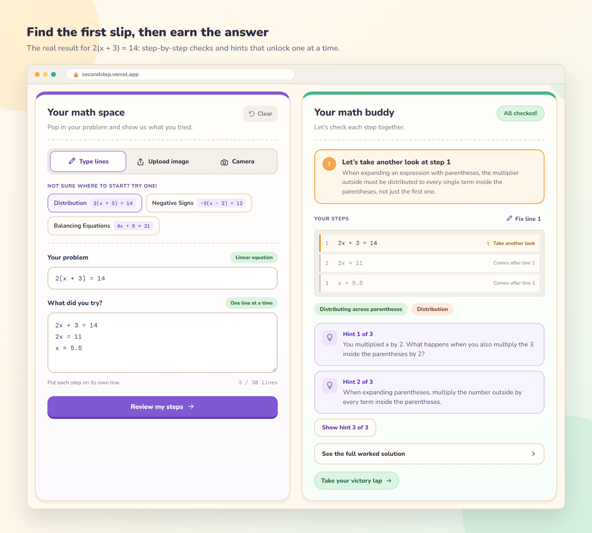
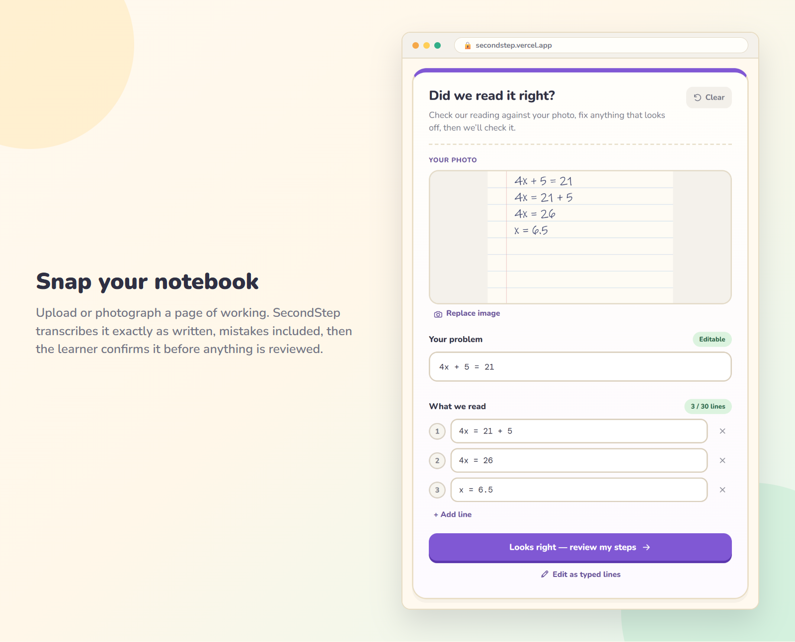
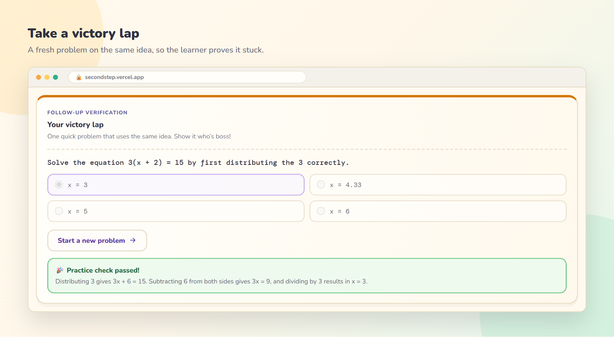
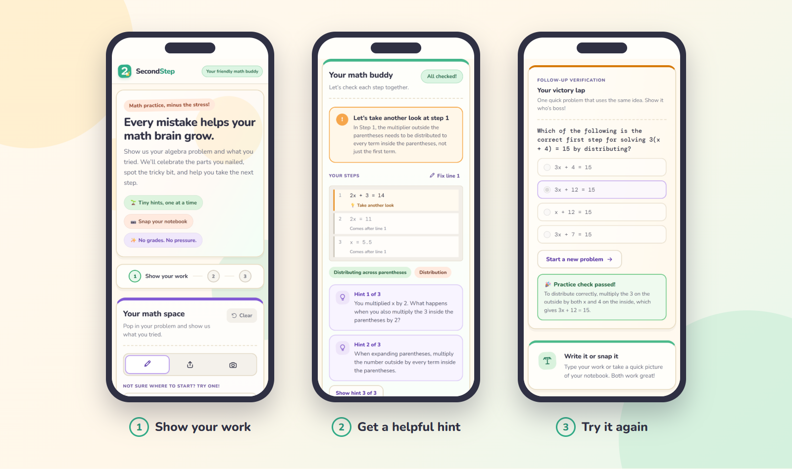
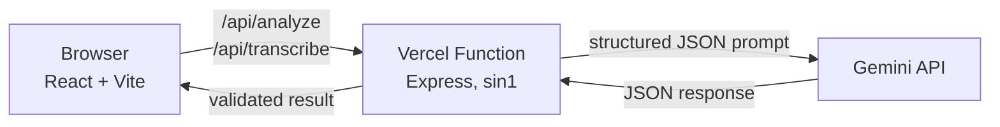

<p align="center">
  
</p>

<p align="center">
  <strong>A friendly algebra helper that finds the first mistake in your working and guides you to fix it yourself.</strong>
</p>

<p align="center">
  <a href="https://secondstep.vercel.app"><strong>Try the live app</strong></a>
</p>

<p align="center">
  
  
  
  
  
</p>

---

## Why SecondStep?

Most math tools hand you the answer, so the mistake never gets fixed. SecondStep works the way a patient tutor does. It reads your own working, points to the first step that went wrong, and gives you one small hint at a time, so the "I did it!" moment is still yours.

## Features

- **Type it or snap it:** enter your steps line by line, upload an image, or use your camera.
- **Finds the first slip:** every step before the mistake is checked, and any valid method is accepted.
- **Hints that unlock one at a time:** three hints, from a gentle question to the specific operation to try.
- **Worked solution on request:** the full correction stays hidden until you ask for it.
- **A victory lap:** a new multiple-choice problem on the same concept shows whether the idea stuck.
- **No grades, no accounts:** there's no sign-in, and the app doesn't store your work.

## See it in action

### Find the first slip, then earn the answer



### Snap your notebook

Handwriting is transcribed exactly as written, mistakes included. You confirm or correct the transcript before anything is reviewed.



### Take a victory lap



### Works on your phone



## What it covers

SecondStep is built for foundational algebra with adult learners (18+) in mind. It supports single-variable linear equations, including:

- Distributing across parentheses, such as `2(x + 3) = 14`
- Negative signs, such as `-3(x - 2) = 12`
- Inverse operations, such as `4x + 5 = 21`
- Variables on both sides, and fractions or decimals in linear equations

Anything outside that scope is reported as unsupported, not guessed at.

## How it works



The Gemini key stays on the server. The Express API validates each request, calls Gemini with a strict JSON schema, and checks the response before it reaches the browser. If the default model fails, it falls back to the other Flash model.

| Endpoint | Method | Purpose |
| --- | --- | --- |
| `/api/health` | `GET` | Reports status, whether a key is set, and the default model |
| `/api/analyze` | `POST` | Reviews a problem and its steps |
| `/api/transcribe` | `POST` | Reads a problem and steps from an image |

## Getting started

### Prerequisites

- Node.js 22.12 or later
- A [Gemini API key](https://aistudio.google.com/apikey)

### Run locally

```bash
git clone https://github.com/Sadman-11/SecondStep.git
cd SecondStep
npm run install:all
cp .env.example .env
```

Add your key to `.env`, then start the app:

```bash
npm run dev
```

Open http://localhost:5173. Vite serves the frontend and proxies `/api` to the Express server, which listens on port 5000 by default.

### Environment variables

| Variable | Required | Default | Description |
| --- | --- | --- | --- |
| `GEMINI_API_KEY` | Yes | None | Server-side Gemini API key |
| `GEMINI_MODEL` | No | `gemini-flash-lite-latest` | Default Gemini model |
| `ANALYZE_TIMEOUT_MS` | No | `40000` | Timeout for AI requests, in milliseconds |
| `RATE_LIMIT_MAX` | No | `120` | Requests allowed per client per minute |
| `MAX_CONCURRENT_ANALYSES` | No | `30` | Concurrent AI requests per server instance |
| `ANALYZE_DISABLED` | No | Unset | Set to `true` to turn off the AI endpoints |

> [!WARNING]
> Never set `VITE_GEMINI_API_KEY` in production. Vite includes every `VITE_` variable in the public JavaScript bundle, which would expose your key to anyone who visits the site.

## Scripts

| Command | Description |
| --- | --- |
| `npm run dev` | Starts the frontend and API together |
| `npm run build` | Builds the frontend to `dist/` |
| `npm start` | Runs the Express server, which also serves a built `dist/` |
| `npm test` | Runs the unit tests |
| `npm run test:integration` | Builds the app and runs the integration tests |
| `npm run test:browser` | Builds the app and runs browser tests in Chrome or Edge |
| `npm run check` | Syntax-checks key files and builds the app |
| `npm run deploy` | Deploys to Vercel production (requires the Vercel CLI) |

## Deploying to Vercel

`vercel.json` already sets the build, the `/api` rewrites, and the Singapore region (`sin1`).

```bash
npm i -g vercel
vercel link
vercel env add GEMINI_API_KEY production
vercel deploy --prod
```

> [!NOTE]
> Vercel limits function request bodies to 4.5 MB, which is lower than the image limits in the app. Very large photos may be rejected on Vercel even though they work locally.

## Project structure

```text
SecondStep/
├── api/index.js        # Vercel entry point for the Express app
├── functions/index.js  # Express API: validation, Gemini calls, rate limiting
├── src/
│   ├── components/     # React UI
│   ├── hooks/          # Learning session state
│   ├── lib/            # Validation, image handling, and API clients
│   └── styles.css
├── public/             # Static assets
├── scripts/dev.mjs     # Starts the API and Vite together
├── tests/              # Unit, integration, and browser tests
├── docs/images/        # README images
└── vercel.json         # Build, routing, and region settings
```

## License

ISC, as declared in `package.json`.
